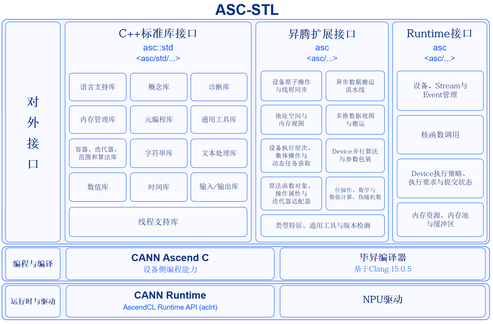

# ASC-STL

面向昇腾设备编程的C++ 标准库 —— 纯头文件实现，为Host与Device提供统一的公共Header组织

简体中文 | [English](README_en.md)

[📖 api文档](docs/zh/api/README.md) | [📚 路线图](docs/zh/roadmap/roadmap.md) | [🧪 快速入门](docs/zh/quick_start.md) | [📄 LICENSE](LICENSE) | [🤝 贡献指南](CONTRIBUTING.md)

## 🔥 最新动态

**[v1.0.0 · 计划2026年10月16日发布]** 完整版本首发：`asc::std`接口层16类标准能力模块、昇腾扩展接口（9类）与Runtime接口（4类）的全部公共头同步提供，共29类能力域，Host与Device代码共用同一套公共Header组织。

### 🚀 版本计划

代码按周更新，版本以**双周**为节奏发布：

| 版本 | 发布日期 | 能力范围 |
| --- | --- | --- |
| **v1.0.0** | **2026-10-16** | 完整版本：C++ 标准库接口（16类标准能力模块）、昇腾扩展接口（9类）与Runtime接口（4类）全量提供 |
| **v1.1.0** | **2026-10-30** | 完善计划第一批 · 质量与性能完善：测试覆盖与真机回归扩展、高频算法与数据搬运路径优化、边界用例补齐 |
| **v1.1.1** | 待定 | 完善计划第二批 · 文档与易用性完善：API参考文档、示例工程、错误诊断与编译体验优化 |

### 📖 文档

- 产品路线图：[ASC-STL总路线图](docs/zh/roadmap/roadmap.md) · [v1.0.0细分路线图](docs/zh/roadmap/roadmap_v1_0_0.md)。
- API参考文档：[ASC-STL API参考](docs/zh/api/README.md)（标准库、昇腾扩展与Runtime接口）。

## 🚀 概述

### 设计目标

昇腾设备计算函数（Kernel）开发需要类型系统、容器与视图、算法、数值、原子、同步、内存和并行操作等通用C++ 功能。ASC-STL以**纯头文件库**形式提供这些能力，不生成独立的动态库或静态库：

- **标准习惯直达Kernel**：类型、算法、数值等通用能力以标准C++ 风格提供，Host与Device共用同一套公共Header组织；
- **平台能力显式表达**：GM/UB地址空间、设备执行层次、设备原子与线程同步、Device并行算法等昇腾平台特性，均有明确、显式的公共接口；
- **Runtime能力封装**：设备、Stream/Event、核函数调用与内存资源等运行时能力以公共C++ 接口提供，不直接暴露底层Runtime API类型。

### 接口组成

| 接口 | 命名空间 / 包含路径 | 覆盖范围 | 随版本提供 |
| --- | --- | --- | --- |
| C++ 标准库接口 | `asc::std` · `<asc/std/...>` | 语言支持、概念、诊断、内存管理、元编程、通用工具、容器、迭代器、范围、算法、字符串、文本处理、数值、日期和时间、输入/输出、并发支持共16类 | v1.0.0 |
| 昇腾扩展接口 | `asc` · `<asc/...>` | 设备原子操作与线程同步、异步数据搬运、地址空间与内存视图、多维数据视图与搬运、设备执行层次与集体操作、Device并行算法及设备侧数值与类型工具共9类 | v1.0.0 |
| Runtime接口 | `asc` · `<asc/...>` | 设备/Stream/Event管理、核函数调用、Device执行策略与执行要求、内存资源/内存池/缓冲区共4类 | v1.0.0 |


### 整体架构



- ASC-STL为纯头文件C++ 库，接口分为C++ 标准库接口、昇腾扩展接口和Runtime接口三部分；
- 设备侧编程能力基于CANN Ascend C提供，代码由毕昇编译器（基于Clang 15.0.5）编译，运行于昇腾950PR&&DT处理器；
- 运行时依赖CANN Runtime（AscendCL Runtime API）与NPU驱动，提供设备管理、核函数调用、内存管理及设备访问能力。

### 如何选择能力

- 写通用的类型、算法、数值与同步逻辑 → 使用 **C++ 标准库接口**（v1.0.0提供）；
- 操作GM/UB内存、设备原子与线程协作、Device并行算法 → 使用 **昇腾扩展接口**（v1.0.0提供）；
- 管理设备、Stream/Event与核函数调用 → 使用 **Runtime接口**（v1.0.0提供）。

## 🔍 目录结构

ASC-STL采用纯头文件库结构。公共Header集中在`include/asc/`；测试、CMake配置和检查脚本分别位于独立目录。

```text
asc-stl/
├── include/
│   └── asc/                         # ASC-STL 公共 Header 根目录
│       ├── __config                 # 统一配置入口
│       ├── std/                     # C++ 标准库接口：<asc/std/...>（v1.0.0）
│       │   └── ...                  # 其余内部实现目录（__ 前缀）
│       ├── algorithm                # Device 并行算法（v1.0.0）
│       ├── atomic                   # 设备原子操作（v1.0.0）
│       ├── collectives              # 线程组协作操作（v1.0.0）
│       ├── execution                # Device 执行策略聚合入口（v1.0.0）
│       ├── memory                   # GM、UB 和内存视图（v1.0.0）
│       ├── stream                   # stream 和 event 管理（v1.0.0）
│       └── ...                      # 其他设备能力公共 Header（v1.0.0）
├── docs/                            # 项目文档与产品路线图
├── test/                            # Host、Device 与仿真测试
├── cmake/                           # CMake 安装和导出配置
├── scripts/                         # 构建检查脚本
├── CMakeLists.txt                   # 顶层 CMake 配置
├── version.cmake                    # 版本定义
├── build.sh                         # 构建与测试入口脚本
├── README.md                        # 项目说明
└── LICENSE                          # 产品许可证
```

`include/asc/std/`下的公共头以`<asc/std/...>`形式提供标准库能力入口；`include/asc/`下其余公共头以`<asc/...>`形式提供昇腾扩展与Runtime能力入口。

## ⚡️ 快速入门

若您希望快速体验 ASC-STL 的使用过程，请访问 [快速入门](docs/zh/quick_start.md)：介绍环境搭建、Host 侧与 Kernel 侧（核函数）的使用方式、编译执行与本地验证，含经测试验证的 Host / Kernel 示例。

使用方式概览：ASC-STL 自身采用纯头文件形式，不单独构建库文件。普通Host算法与类型设施可直接包含公共头使用；调用依赖AscendCL的Runtime接口还须安装相应CANN运行时并链接`ascendcl`，按接口要求初始化设备与资源。Host侧需要支持C++17的编译器及相应系统库，Kernel编译与真机运行需要CANN，详见[软硬件配套说明](#-软硬件配套说明)。

### 环境要求

| 依赖 | 版本 / 说明 |
| --- | --- |
| CANN | 9.2.0 |
| 毕昇CCE / clang | 15.0.5 |
| g++ | 产品最低使用C++17；完整Host测试同时需要C++20支持 |
| CMake | ≥ 3.20 |
| 处理器 | 昇腾950PR&&DT处理器 |

CANN同一版本的不同构建可能采用不同SDK目录布局。设备层查询会优先包含
`c_api/utils/sys_var.h`，缺少时使用`c_api/sys_var/sys_var.h`；两者均缺少时会给出
编译错误。Tensor描述符的64位乘法溢出检查采用32位分段运算，避免旧版BiSheng
在动态描述符路径生成设备侧不可用的`__multi3`链接符号；公共接口和状态码保持不变。

Host标准库接口还依赖配套的C库和C++ 标准库。C++20 `<asc/std/cuchar>`的
`c8rtomb`、`mbrtoc8`需要系统`<cuchar>`实际导出这两个接口；GNU/Linux通常需要
glibc 2.36或更新版本，以及构建时启用了相应能力的libstdc++。只升级编译器不足以
满足要求，应在同一环境中检查编译、链接和运行。Ubuntu 24.04的GCC 13/glibc 2.39
可提供这组接口；不要把新版glibc全局注入旧CANN环境。完整Host门禁会检查
C++17/C++20两种模式，不应因系统库缺失而跳过测试。

### C++语言兼容

C++17是最低语言模式，C++20继续受支持。能够以普通模板表达的较新库接口按已选子集回移；concept判定在C++17为布尔变量模板，C++20为原生concept。语言语法、Host/Device调用位置和常量求值能力分别判断。

`<asc/std/version>`提供值为0或1的`CANN_ASC_STL_HAS_*`能力宏。旧的标准名特性宏默认由Host标准库管理，ASC旧判断代码可通过显式兼容开关迁移。具体接口、配置与迁移方式见[语言模式与兼容性](docs/zh/guide/cpp_compatibility.md)。

### 直接包含（Host示例）

```cpp
// sample.cpp —— 仅依赖头文件，无需链接库
#include <asc/std/optional>
#include <asc/std/type_traits>

int main() {
    static_assert(asc::std::is_integral_v<int>);
    asc::std::optional<int> value = 42;
    return *value == 42 ? 0 : 1;
}
```

```bash
g++ -std=c++17 -Wall -Wextra -I asc-stl/include sample.cpp -o sample && ./sample
```

### CMake集成

```cmake
add_subdirectory(asc-stl)

target_link_libraries(your_target PRIVATE asc_stl::asc_stl)   # INTERFACE 目标，只传 include 路径
```

### 构建与运行测试

```bash
# 方式一：构建入口脚本（默认安装头文件与 CMake 配置到 build/install）
bash build.sh

# 方式二：Host 门禁（风格检查、头文件自包含、C++17/C++20 Host 语义 UT；需要 Python 3）
bash scripts/ci-quick-check.sh

# 方式三：CMake + CTest（显式开启测试目标；设备编译与仿真门禁需 CANN 环境并通过 build.sh --device-compile / --cannsim 开启）
cmake -B build -DBUILD_TESTING=ON && cmake --build build -j && cd build && ctest
```

真实设备回归使用`bash scripts/ci-hardware-check.sh`，默认执行C++17/C++20
各三轮。当前测试入口要求只暴露一个可读写的`/dev/davinci[0-9]+`计算设备节点；
容器中的节点可能是`/dev/davinci4`等非零编号，不能把物理节点尾数当作ACL逻辑
设备号。测试使用逻辑设备0，实际初始化和执行结果仍由运行时测试确认。无计算设备、
权限不足或存在多个计算设备时，入口会报告`BLOCKED_ENVIRONMENT`并以状态码2
退出；`davinci_manager`不计入计算设备。

可选`ASC_STL_HARDWARE_DEVICE_NODE`用来校验预期的物理节点，不改变逻辑设备号，
也不从多设备中选择一个。构建遵循`CMAKE_BUILD_PARALLEL_LEVEL`，未设置时保持
两路并行；例如`CMAKE_BUILD_PARALLEL_LEVEL=8 bash scripts/ci-hardware-check.sh`。
硬件用例不由上面的三个云端Host/Device/cannsim CI入口触发。

纯SIMT测试中，视图连续逆向遍历的已知编译器缺陷与B022常量局部数组组合回归的
独立异常，分别记录于[共享语义回归说明](test/support/README.md)。B022夹具通过
Host上传相同原值构造运行期输入，保留Host/SIMD常量路径、算法调用顺序、断言和
`-O3`；原始常量形态仍需复验。验证该夹具时须完整执行C++17/C++20模拟与真机回归，
算法独立对照不能替代完整B022结果。

B027的纯SIMT运行期测试采用[分阶段夹具](test/support/README.md)：每个阶段在独立ASC
翻译单元和共享模块中编译，长字符串对象及arena位于同一上下文的GM，短字符串保持
局部对象和局部arena。Host与SIMD保留原完整语义路径。该夹具保留core与字符串的
全部行为断言及`-O3`，用于验证当前工具链下的内存域和模块隔离；原单kernel、局部
长arena形态仍作为独立回归保留在诊断记录中，不能据此声称SDK问题已经修复。
C++17/C++20的完整模拟、硬件构建和有保护的真机执行均属于持续验证要求。

## 💻 软硬件配套说明

ASC-STL 所需的软硬件环境依赖如下：

- 昇腾产品：[昇腾950PR&&DT处理器](https://www.hiascend.com/hardware/processor)
- CPU 架构：`aarch64` / `x86_64`
- 系统：支持的 Linux（进行[兼容性查询](https://www.hiascend.com/hardware/compatibility)）
- 软件依赖：
  - CANN 9.2.0 及以上（毕昇CCE/clang 15.0.5 与 AscendCL Runtime 随 CANN 提供）
  - CMake ≥ 3.20

不同 ASC-STL 版本可支持的硬件平台及所需的 [CANN](https://www.hiascend.com/developer/download/community/result?module=cann) 版本如下表：

<table style="width: 75%; margin: 0 auto;">
  <colgroup>
    <col style="width: 30%">
    <col style="width: 30%">
    <col style="width: 40%">
  </colgroup>
  <thead>
      <tr>
          <th>ASC-STL 版本</th>
          <th>支持 CANN 包版本</th>
          <th>支持昇腾产品</th>
      </tr>
  </thead>
  <tbody style="text-align: center">
      <tr>
          <td>v1.0.0、v1.1.0、v1.1.1</td>
          <td>社区版 9.2.0 及以上</td>
          <td><a href="https://www.hiascend.com/hardware/processor">昇腾950PR&&DT处理器</a></td>
      </tr>
  </tbody>
</table>

## 🧰 IDE支持

工程已配置`CMAKE_EXPORT_COMPILE_COMMANDS`，构建后会在构建目录生成`compile_commands.json`，供clangd / VS Code等IDE使用。纯头文件库自身没有编译单元，该数据库由测试编译目标产生：

```bash
cmake -B build            # 生成 build/compile_commands.json
ln -sf build/compile_commands.json .
```

设备侧代码的条件编译宏由CCE工具链注入；IDE线上预览Device路径的配置指引待定。

## 📊 版本状态与功能清单

当前状态：**v1.0.0（完整版本）开发中，计划于2026年10月16日发布**。

| 能力域 | 关键公共头 | 随版本提供 |
| --- | --- | --- |
| 类型系统与通用工具 | `type_traits` `concepts` `tuple` `optional` `variant` `expected` `functional` `bit` … | v1.0.0 |
| 语言支持与诊断 | `limits` `exception` `compare` `new` `version` `cassert` `system_error` … | v1.0.0 |
| 顺序算法、迭代器与范围 | `algorithm` `iterator` `ranges` `execution` | v1.0.0 |
| 容器与视图 | `array` `vector` `inplace_vector` `map` `set` `span` `mdspan` … | v1.0.0 |
| 字符串与文本处理 | `string` `string_view` `charconv` `format` … | v1.0.0 |
| 数值与时间 | `cmath` `complex` `random` `linalg` `numeric` `chrono` … | v1.0.0 |
| 标准原子与同步 | `atomic` `barrier` `latch` `semaphore` `mutex` | v1.0.0 |
| 内存管理 | `memory` `scoped_allocator` | v1.0.0 |
| 设备与任务提交 | `devices` `stream` `launch` `execution.*` | v1.0.0 |
| 内存资源与数据搬运 | `memory` `memory_resource` `memory_pool` `buffer` `mdspan` `tensor_copy` `pipeline` | v1.0.0 |
| 设备原子与线程同步 | `atomic` `barrier` `latch` `semaphore` | v1.0.0 |
| 设备执行层次与集体操作 | `hierarchy` `warp` `collectives` `work_queue` | v1.0.0 |
| Device并行算法与配套组件 | `algorithm` `argument` `functional` `iterator` `bit` `cmath` `numeric` `random` `type_traits` `utility` `version` | v1.0.0 |

## 📖 相关资源

### 文档

| 文档 | 说明 |
| --- | --- |
| [快速入门](docs/zh/quick_start.md) | 环境搭建、Host/Kernel 使用方式与本地验证，含经测试验证的示例 |
| [产品路线图](docs/zh/roadmap/roadmap.md) | 版本发布计划与各版本能力范围 |
| [v1.0.0细分路线图](docs/zh/roadmap/roadmap_v1_0_0.md) | 完整版本的条目级说明：C++ 标准库、昇腾扩展与Runtime能力 |
| [贡献指南](CONTRIBUTING.md) | 贡献流程、贡献场景与代码/测试要求 |
| [API参考文档](docs/zh/api/README.md) | ASC-STL公开接口的参考文档入口：标准库、昇腾扩展与Runtime |

## 📌 相关规划

- [ASC-STL总路线图](docs/zh/roadmap/roadmap.md)：库功能按周更新，版本自2026年10月第2周起以双周为节奏发布；10月16日发布v1.0.0完整版本（C++ 标准库接口、昇腾扩展接口与Runtime接口全量），10月30日发布v1.1.0（完善计划第一批：质量与性能完善），后续完善批次发布时间待定；
- [v1.0.0细分路线图](docs/zh/roadmap/roadmap_v1_0_0.md)：类型系统、算法、容器视图、字符串文本、数值时间、标准同步、内存管理及昇腾扩展与Runtime能力的条目级说明。

## 👥 合作贡献者

- 武汉理工大学熊盛武老师团队
- 路雄博、蒋振宇、王亦柯

## 📝 相关信息

- **安全声明**：[SECURITY.md](SECURITY.md)；
- **许可证**：[Apache License 2.0](LICENSE)。
