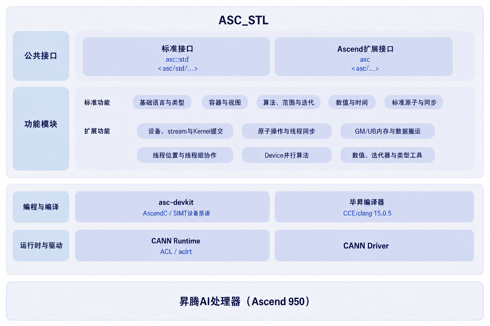

# ASC-STL

#### 面向昇腾设备编程的 C++ 标准库 —— 纯头文件实现，为 Host 与 Device 提供统一的公共 Header 组织

[📖 官方文档](#)（待定） | [📚 项目文档](docs/roadmap/) | [🧪 示例](#)（待定） | [🛠 工具脚本](#)（待定） | [📄 LICENSE](#)（待定） | [🤝 贡献指南](CONTRIBUTING.md)

## 🔥 最新动态

**[v1.0.0-preview版本关键能力]** 通用编程能力主体就绪。

### 🚀 关键能力

- 类型系统与通用工具（`type_traits` / `tuple` / `optional` / `functional` 等）主体公共头落地并通过测试验证。
- 顺序算法与迭代、数值与时间、容器与视图、标准原子与同步能力域主体可用。
- 其它通用编程能力。

### 🎯 样例更新

- Host 单元测试、单头自包含编译检查（host / kernel）样例随包提供。
- cannsim 数值仿真与真机抽验用例持续扩充。

### 📖 资料文档

- 方案设计说明书：总体架构、模块划分与全部公共入口定义。
- 阶段路线图：[v1.0.0-preview · 通用编程能力](docs/roadmap/ROADMAP-Stage1.md) / [v1.1.0 · 设备编程能力](docs/roadmap/ROADMAP-Stage2.md)。

## 🚀 概述

### 设计目标

昇腾设备计算函数（Kernel）开发需要类型系统、容器与视图、算法、数值、原子、同步、内存和并行操作等通用 C++ 功能。ASC-STL 以**纯头文件库**形式提供这些能力，不生成独立的动态库或静态库：

- **标准习惯直达 Kernel**：类型、算法、数值等通用能力以标准 C++ 风格提供，Host 与 Device 共用同一套公共 Header 组织；
- **平台能力显式表达**：内存、线程和并行任务等昇腾平台特性，均有明确、显式的公共接口。

### 能力域总览

| 能力域 | 核心特性  | 核心价值 | 发布阶段 |
| --- | --- | --- | --- |
| 通用编程 | 类型、容器视图、顺序算法、数值与时间、标准原子同步  | 零学习成本的标准习惯 | 阶段一（当前） |
| 设备编程 | stream、GM/UB 内存与搬运、设备原子同步、线程层次协作  | 直达昇腾平台资源与执行模型 | 阶段二 |

> 后续能力范围待前两阶段收尾后另行规划。

### 整体架构



- ASC-STL 本身为纯头文件 C++ 库，由公共接口和功能模块组成，不生成独立的动态库或静态库；
- 依赖 asc-devkit 提供的 AscendC 和 SIMT 设备编程能力，完成 Host 与 Device 代码的编译；
- 运行时依赖 CANN Runtime 和 CANN Driver 提供设备管理、任务提交、内存管理及硬件驱动能力。

### 如何选择能力

- 写通用的类型、算法、数值与同步逻辑 → 使用**通用编程能力**（当前已提供）；
- 操作设备资源、GM/UB 与线程 → 使用**设备编程能力**（阶段二发布）。

## 🔍 目录结构

ASC-STL 采用纯头文件库结构。公共 Header 集中在 `include/asc/`；测试、CMake 配置和持续集成脚本分别位于独立目录。

```text
asc-stl/
├── include/
│   └── asc/                         # ASC-STL 公共 Header 根目录
│       ├── std/                     # 通用能力入口：<asc/std/...>
│       │   ├── detail/              # 统一配置入口
│       │   └── ...                  # 其余内部实现目录（__ 前缀）
│       ├── algorithm                # 并行算法
│       ├── atomic                   # 设备原子操作（阶段二）
│       ├── collectives              # 线程组协作操作（阶段二）
│       ├── execution                # Device 执行策略聚合入口（阶段二）
│       ├── memory                   # GM、UB 和内存视图（阶段二）
│       ├── stream                   # stream 和 event 管理（阶段二）
│       └── ...                      # 其他设备能力公共 Header
├── docs/                            # 项目文档与阶段路线图
├── test/                            # Host、Device、cannsim 与真机测试
├── cmake/                           # CMake 安装和导出配置
├── scripts/                         # 构建检查与持续集成脚本
├── CMakeLists.txt                   # 顶层 CMake 配置
├── README.md                        # 项目说明
└── LICENSE                          # 产品许可证
```

`include/asc/std/` 下的公共头以 `<asc/std/...>` 形式提供通用能力入口；`include/asc/` 下其余公共头以 `<asc/...>` 形式提供设备能力入口。当前阶段部分公共入口以细粒度头提供，阶段一收尾将统一收口为标准伞头入口。

## ⚡️ 快速入门

### 环境要求

| 依赖 | 版本 / 说明 | 备注 |
| --- | --- | --- |
| CANN | 9.2.0 | 兼容版本矩阵待定 |
| 毕昇 CCE / clang | 15.0.5 | Host 与 Device 编译 |
| g++ | 支持 C++17 的版本 | Host 单元测试 |
| CMake | ≥ 3.18 | 构建与测试组织 |
| 处理器 | 昇腾 AI 处理器（Ascend 950） | 仿真测试不要求真机 |


### 直接包含（Host 示例）

```cpp
// sample.cpp —— 仅依赖头文件，无需链接库
#include <asc/std/optional>
#include <asc/std/type_traits>

int main() {
    static_assert(asc::std::is_integral_v<int>);
    asc::std::optional<int> value = 42;
    return *value == 42 ? 0 : 1;
}
```

```bash
g++ -std=c++17 -Wall -Wextra -I asc-stl/include sample.cpp -o sample && ./sample
```

### CMake 集成

```cmake
add_subdirectory(asc-stl)

target_link_libraries(your_target PRIVATE asc-stl)   # INTERFACE 目标，只传 include 路径
```

### 构建与运行测试

```bash
# 方式一：脚本直跑 Host 回归
./run_host_test.sh

# 方式二：CMake + CTest（含 Host / Device 编译 / cannsim 仿真测试）
cmake -B build && cmake --build build -j && cd build && ctest
```

## 🧰 IDE 支持

工程已配置 `CMAKE_EXPORT_COMPILE_COMMANDS`，构建后会在构建目录生成 `compile_commands.json`，供 clangd / VS Code 等 IDE 使用：

```bash
cmake -B build            # 生成 build/compile_commands.json
ln -sf build/compile_commands.json .
```

设备侧代码的条件编译宏由 CCE 工具链注入；IDE 线上预览 Device 路径的配置指引待定。

## 📊 版本状态与功能清单

当前版本：**阶段一 Preview（通用编程能力，v1.0.0-preview）**。

| 能力域 | 当前状态 | 发布阶段 | 说明 |
| --- | --- | --- | --- |
| 库基础设施（配置入口/命名空间/执行空间宏/构建） | ✅ 可用 | 阶段一 | 统一配置入口、`_ASC_API` 体系、CMake `INTERFACE` 目标 |
| 质量工程（单测检查/仿真） | ✅ 可用 | 阶段一 | 自包含编译检查 + cannsim 数值仿真  |
| 类型系统与通用工具（type_traits/utility/tuple/optional/…） | ✅ 主体可用 | 阶段一 | 覆盖度最高的能力域，持续补齐 |
| 数值与时间（numeric/bit/cmath/chrono/…） | ✅ 主体可用 | 阶段一 | — |
| 顺序算法（algorithm/iterator/ranges） | 🚧 收尾中 | 阶段一 | 主体可用；伞头入口归一进行中 |
| 容器与视图（array/inplace_vector/span/string_view/…） | 🚧 收尾中 | 阶段一 | 固定容量子集可用；设备侧动态容器范围待定 |
| 标准原子与同步（atomic/barrier/latch/…） | 🚧 收尾中 | 阶段一 | — |
| 公共伞头入口归一（`<asc/std/algorithm>` 等统一入口） | 📋 规划 | 阶段一收尾项 | — |
| 设备与任务提交（devices/stream/launch/execution） | 📋 规划 | 阶段二 | 部分基础头已先行随阶段一完成 |
| 内存与数据搬运（memory/buffer/tensor_copy/mdspan） | 📋 规划 | 阶段二 | — |
| 设备原子与线程同步（GM/UB 地址空间、pipeline） | 📋 规划 | 阶段二 | 部分基础头已先行随阶段一完成 |
| 线程层次与组协作（hierarchy/warp/collectives/work_queue） | 📋 规划 | 阶段二 | — |
| 设备侧数值与类型工具（bit/cmath/numeric/random/…） | 📋 规划 | 阶段二 | — |


## 📖 相关资源

### 项目文档

| 文档 | 说明 |
| --- | --- |
| [方案设计说明书](docs/ASC-STL_方案设计说明书.docx) | 总体架构、模块划分与全部公共入口定义 |
| [贡献指南](CONTRIBUTING.md) | 贡献流程、贡献场景与代码/测试要求 |
| SIMT编程api参考文档 | 待定 |
| 示例 | 待定 |

## 📌 相关规划

- [ASC-STL · 通用编程能力 Roadmap](docs/roadmap/ROADMAP-Stage1.md)：类型、算法、数值、容器视图与标准同步的全量交付及首个代码包发布（v1.0.0-preview）；
- [ASC-STL · 设备编程能力 Roadmap](docs/roadmap/ROADMAP-Stage2.md)：设备任务提交、内存搬运、设备原子同步与线程层次协作（v1.1.0）。

## 📝 相关信息

- **贡献指南**：见 [CONTRIBUTING.md](CONTRIBUTING.md)；
- **安全声明**：待定；
- **许可证**：待定。
