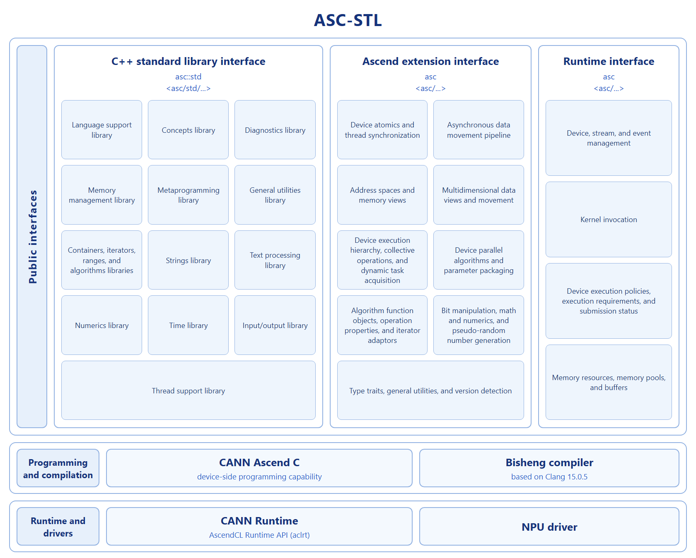

# ASC-STL

#### A C++ standard library for Ascend device programming — header-only, with a single public header organization shared by Host and Device code

English | [简体中文](./README.md)

[📖 API Reference](docs/zh/api/README.md) | [📚 Roadmap](docs/roadmap/ROADMAP.md) | [📄 LICENSE](LICENSE) | [🤝 Contributing](CONTRIBUTING.md)

## 🔥 Latest News

**[v1.0.0 · planned for October 16, 2026]** Initial full release: all public headers of the `asc::std` interface layer (16 categories of standard-library capabilities), the Ascend extension interfaces (9 categories), and the Runtime interfaces (4 categories) are provided together — 29 capability domains in total, with Host and Device code sharing a single public header organization.

### 🚀 Release Plan

Code is updated weekly, and versions are released on a **biweekly** cadence:

| Version | Release date | Scope |
| --- | --- | --- |
| **v1.0.0** | **2026-10-16** | Full release: the complete C++ standard library interfaces (16 categories of standard-library capabilities), Ascend extension interfaces (9 categories), and Runtime interfaces (4 categories) |
| **v1.1.0** | **2026-10-30** | Refinement plan, batch 1 · Quality and performance: extended test coverage and on-target regression, optimization of high-frequency algorithms and data-movement paths, and additional edge-case tests |
| **v1.1.1** | TBD | Refinement plan, batch 2 · Documentation and usability: API reference documentation, sample projects, error diagnostics, and improved build experience |

### 📖 Documentation

- Product roadmap: [ASC-STL roadmap](docs/roadmap/ROADMAP.md) · [v1.0.0 detailed roadmap](docs/roadmap/ROADMAP-v1.0.0.md)
- API reference: [ASC-STL API Reference](docs/zh/api/README.md) (standard library, Ascend extensions, and Runtime interfaces)

## 🚀 Overview

### Design Goals

Developing compute kernels for Ascend devices requires general-purpose C++ facilities such as the type system, containers and views, algorithms, numerics, atomics, synchronization, memory, and parallel operations. ASC-STL delivers these capabilities as a **header-only library** and produces no separate dynamic or static library:

- **Standard idioms straight into kernels**: types, algorithms, numerics, and other general-purpose facilities are provided in standard C++ style, with Host and Device code sharing a single public header organization;
- **Platform capabilities made explicit**: Ascend platform features — the GM/UB address spaces, the device execution hierarchy, device atomics and thread synchronization, and device parallel algorithms — all have well-defined, explicit public interfaces;
- **Runtime capabilities encapsulated**: runtime facilities such as devices, streams/events, kernel invocation, and memory resources are exposed through public C++ interfaces, without leaking low-level Runtime API types.

### Interface Composition

| Interface | Namespace / include path | Scope | Delivered in |
| --- | --- | --- | --- |
| C++ standard library interface | `asc::std` · `<asc/std/...>` | 16 categories: language support, concepts, diagnostics, memory management, metaprogramming, general utilities, containers, iterators, ranges, algorithms, strings, text processing, numerics, date and time, input/output, and concurrency support | v1.0.0 |
| Ascend extension interface | `asc` · `<asc/...>` | 9 categories: device atomics and thread synchronization, asynchronous data movement, address spaces and memory views, multidimensional data views and movement, device execution hierarchy and collective operations, device parallel algorithms, and device-side numerics and type utilities | v1.0.0 |
| Runtime interface | `asc` · `<asc/...>` | 4 categories: device/stream/event management, kernel invocation, device execution policies and execution requirements, and memory resources/memory pools/buffers | v1.0.0 |

### Overall Architecture



- ASC-STL is a header-only C++ library whose interfaces fall into three parts: the C++ standard library interfaces, the Ascend extension interfaces, and the Runtime interfaces;
- Device-side programming capability builds on CANN Ascend C; code is compiled by the BiSheng compiler (based on Clang 15.0.5) and runs on the Ascend 950 processor;
- Runtime dependencies are the CANN Runtime (AscendCL Runtime API) and the NPU driver, which provide device management, kernel invocation, memory management, and device access.

### Choosing the Right Facilities

- For general-purpose types, algorithms, numerics, and synchronization logic → use the **C++ standard library interfaces** (available since v1.0.0);
- For GM/UB memory operations, device atomics and thread cooperation, and device parallel algorithms → use the **Ascend extension interfaces** (available since v1.0.0);
- For managing devices, streams/events, and kernel invocation → use the **Runtime interfaces** (available since v1.0.0).

## 🔍 Directory Layout

ASC-STL is organized as a header-only library. Public headers live under `include/asc/`; tests, CMake configuration, and check scripts live in separate directories.

```text
asc-stl/
├── include/
│   └── asc/                         # Root of the ASC-STL public headers
│       ├── std/                     # C++ standard library interfaces: <asc/std/...> (v1.0.0)
│       │   ├── detail/              # Unified configuration entry
│       │   └── ...                  # Other internal implementation directories (__ prefix)
│       ├── algorithm                # Device parallel algorithms (v1.0.0)
│       ├── atomic                   # Device atomic operations (v1.0.0)
│       ├── collectives              # Thread-group cooperative operations (v1.0.0)
│       ├── execution                # Aggregate entry for device execution policies (v1.0.0)
│       ├── memory                   # GM, UB, and memory views (v1.0.0)
│       ├── stream                   # Stream and event management (v1.0.0)
│       └── ...                      # Other device-capability public headers (v1.0.0)
├── docs/                            # Project documentation and product roadmap
├── test/                            # Host, device, and simulation tests
├── cmake/                           # CMake install and export configuration
├── scripts/                         # Build and check scripts
├── CMakeLists.txt                   # Top-level CMake configuration
├── version.cmake                    # Version definitions
├── build.sh                         # Build and test entry script
├── README.md                        # Project README (Chinese)
├── README_en.md                     # Project README (English)
└── LICENSE                          # Product license
```

The public headers under `include/asc/std/` provide the standard-library entry points included as `<asc/std/...>`; the remaining public headers under `include/asc/` provide the Ascend extension and Runtime entry points included as `<asc/...>`.

## ⚡️ Quick Start

### Requirements

| Dependency | Version / notes |
| --- | --- |
| CANN | 9.2.0 |
| BiSheng CCE / clang | 15.0.5 |
| g++ | C++17 as the product minimum; the full Host test suite additionally requires C++20 support |
| CMake | ≥ 3.20 |
| Processor | Ascend 950 processor |

Different builds of the same CANN version may use different SDK directory layouts. The device-layer queries first include `c_api/utils/sys_var.h` and fall back to `c_api/sys_var/sys_var.h`; a compilation error is raised when neither is present. The 64-bit multiply-overflow check for Tensor descriptors uses 32-bit segmented arithmetic to keep older BiSheng versions from emitting a device-side `__multi3` symbol that cannot be linked on the dynamic-descriptor path; the public interfaces and status codes are unchanged.

The Host standard-library interfaces also depend on the accompanying C library and the C++ standard library. The C++20 `<asc/std/cuchar>` interfaces `c8rtomb` and `mbrtoc8` require the system `<cuchar>` to actually export them; on GNU/Linux this usually means glibc 2.36 or newer together with a libstdc++ built with the corresponding capabilities. Upgrading the compiler alone is therefore not sufficient — compilation, linking, and execution should be verified in the same environment. Ubuntu 24.04 with GCC 13 / glibc 2.39 provides this set of interfaces; do not inject a newer glibc globally into an older CANN environment. The full Host gate exercises both C++17 and C++20 modes and must not skip tests because system libraries are missing.

### Include Directly (Host Example)

```cpp
// sample.cpp — headers only, no library to link against
#include <asc/std/optional>
#include <asc/std/type_traits>

int main() {
    static_assert(asc::std::is_integral_v<int>);
    asc::std::optional<int> value = 42;
    return *value == 42 ? 0 : 1;
}
```

```bash
g++ -std=c++17 -Wall -Wextra -I asc-stl/include sample.cpp -o sample && ./sample
```

### CMake Integration

```cmake
add_subdirectory(asc-stl)

target_link_libraries(your_target PRIVATE asc-stl)   # INTERFACE target; propagates include paths only
```

### Building and Running Tests

```bash
# Option 1: build entry script (installs headers and CMake configuration to build/install by default)
bash build.sh

# Option 2: Host gate (style checks, self-containedness of public headers, C++17/C++20 Host semantic
#           unit tests; requires Python 3)
bash scripts/ci-quick-check.sh

# Option 3: CMake + CTest (test targets must be enabled explicitly; the device-compile and simulation
#           gates require a CANN environment and are enabled via build.sh --device-compile / --cannsim)
cmake -B build -DBUILD_TESTING=ON && cmake --build build -j && cd build && ctest
```

On-target regression uses `bash scripts/ci-hardware-check.sh`, which by default runs three rounds each in C++17 and C++20 modes. The test entry currently requires exactly one readable and writable `/dev/davinci[0-9]+` compute device node; in containers the node may carry a non-zero index such as `/dev/davinci4`, and the trailing digits of a physical node must not be treated as an ACL logical device ID. Tests use logical device 0, and actual initialization and execution results are still confirmed by the runtime tests. When no compute device is present, permissions are insufficient, or more than one compute device exists, the entry reports `BLOCKED_ENVIRONMENT` and exits with status code 2; `davinci_manager` is not counted as a compute device.

The optional `ASC_STL_HARDWARE_DEVICE_NODE` validates the expected physical node; it neither changes the logical device ID nor selects among multiple devices. Builds honor `CMAKE_BUILD_PARALLEL_LEVEL` and default to two-way parallelism when it is unset; for example, `CMAKE_BUILD_PARALLEL_LEVEL=8 bash scripts/ci-hardware-check.sh`. The hardware cases are not triggered by the three cloud Host/Device/cannsim CI entries above.

## 🧰 IDE Support

The project sets `CMAKE_EXPORT_COMPILE_COMMANDS`; after configuration, `compile_commands.json` is generated in the build directory for clangd, VS Code, and other IDEs. As a header-only library has no compilation units of its own, this database is produced by the test build targets:

```bash
cmake -B build            # generates build/compile_commands.json
ln -sf build/compile_commands.json .
```

Conditional-compilation macros for device-side code are injected by the CCE toolchain; guidance for previewing device paths in online IDEs is TBD.

## 📊 Version Status and Feature Inventory

Current status: **v1.0.0 (full release) under development, planned for October 16, 2026**.

| Capability domain | Key public headers | Delivered in |
| --- | --- | --- |
| Type system and general utilities | `type_traits` `concepts` `tuple` `optional` `variant` `expected` `functional` `bit` … | v1.0.0 |
| Language support and diagnostics | `limits` `exception` `compare` `new` `version` `cassert` `system_error` … | v1.0.0 |
| Sequential algorithms, iterators, and ranges | `algorithm` `iterator` `ranges` `execution` | v1.0.0 |
| Containers and views | `array` `vector` `inplace_vector` `map` `set` `span` `mdspan` … | v1.0.0 |
| Strings and text processing | `string` `string_view` `charconv` `format` … | v1.0.0 |
| Numerics and time | `cmath` `complex` `random` `linalg` `numeric` `chrono` … | v1.0.0 |
| Standard atomics and synchronization | `atomic` `barrier` `latch` `semaphore` `mutex` | v1.0.0 |
| Memory management | `memory` `scoped_allocator` | v1.0.0 |
| Devices and task submission | `devices` `stream` `launch` `execution.*` | v1.0.0 |
| Memory resources and data movement | `memory` `memory_resource` `memory_pool` `buffer` `mdspan` `tensor_copy` `pipeline` | v1.0.0 |
| Device atomics and thread synchronization | `atomic` `barrier` `latch` `semaphore` | v1.0.0 |
| Device execution hierarchy and collective operations | `hierarchy` `warp` `collectives` `work_queue` | v1.0.0 |
| Device parallel algorithms and supporting components | `algorithm` `argument` `functional` `iterator` `bit` `cmath` `numeric` `random` `type_traits` `utility` `version` | v1.0.0 |

## 📖 Resources

### Documentation

| Document | Description |
| --- | --- |
| [Product roadmap](docs/roadmap/ROADMAP.md) | Release plan and per-version capability scope |
| [v1.0.0 detailed roadmap](docs/roadmap/ROADMAP-v1.0.0.md) | Entry-level description of the full release: C++ standard library, Ascend extensions, and Runtime capabilities |
| [Contributing guide](CONTRIBUTING.md) | Contribution workflow, contribution scenarios, and code/test requirements |
| [API reference](docs/zh/api/README.md) | Entry point to the ASC-STL public-interface reference: standard library, Ascend extensions, and Runtime |

## 📌 Related Plans

- [ASC-STL roadmap](docs/roadmap/ROADMAP.md): library features are updated weekly, and versions have been released on a biweekly cadence since the second week of October 2026; the full v1.0.0 release (C++ standard library interfaces, Ascend extension interfaces, and Runtime interfaces in their entirety) ships on October 16, followed by v1.1.0 on October 30 (refinement plan, batch 1: quality and performance); dates for later refinement batches are TBD;
- [v1.0.0 detailed roadmap](docs/roadmap/ROADMAP-v1.0.0.md): entry-level descriptions of the type system, algorithms, containers and views, strings and text, numerics and time, standard synchronization, memory management, and the Ascend extension and Runtime capabilities.

## 📝 Additional Information

- **Security statement**: [SECURITY.md](SECURITY.md);
- **License**: [Apache License 2.0](LICENSE).
