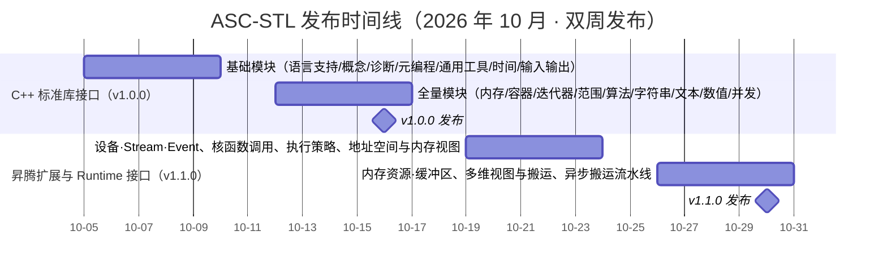

# ASC-STL ROADMAP

> **细分路线图**：[v1.0.0 · C++ 标准库能力全量（2026-10-16 发布）](ROADMAP-v1.0.0.md)

## 项目概述

ASC-STL 是面向昇腾设备核函数编程的纯头文件 C++ 库，同时服务主机侧与设备侧代码，最低支持 C++17；依赖 C++20 语言特性的接口在 C++20 及以上语言模式下开放。

接口分为三部分：

| 接口 | 命名空间 / 包含路径 | 覆盖范围 |
| --- | --- | --- |
| C++ 标准库接口 | `asc::std` · `<asc/std/...>` | 语言支持、概念、诊断、内存管理、元编程、通用工具、容器、迭代器、范围、算法、字符串、文本处理、数值、日期和时间、输入/输出、并发支持共 16 类标准能力 |
| 昇腾扩展接口 | `asc` · `<asc/...>` | 设备原子操作与线程同步、异步数据搬运流水线、地址空间与内存视图、多维数据视图与搬运、设备执行层次与集体操作、Device 并行算法与参数包装、算法函数对象与迭代器适配器、位操作/数学/数值/伪随机数、类型特征/通用工具/版本检测共 9 类扩展能力 |
| Runtime 接口 | `asc` · `<asc/...>` | 设备/Stream/Event 管理、核函数调用、Device 执行策略与执行要求、内存资源/内存池/缓冲区共 4 类运行时能力 |

自 2026 年 10 月起，ASC-STL 库内功能保持**每周更新**，以**双周**为节奏开源发布：首个版本 **v1.0.0** 于 **10 月 16 日**发布，完整支持 C++ 标准库能力；**v1.1.0** 于 **10 月 30 日**发布；包含全部昇腾扩展的完整版本 **v1.1.1** 发布时间待定。

## 版本发布计划

首次开源于 10 月第 2 周。

| 版本 | 发布日期 | 新交付能力 |
| --- | --- | --- |
| **v1.0.0** | **2026-10-16（10 月第 2 周）** | **C++ 标准库能力全量**：语言支持、概念、诊断、元编程、通用工具、日期和时间、输入/输出、内存管理、容器、迭代器、范围、算法、字符串、文本处理、数值、并发支持，16 类标准能力模块全部可用 |
| **v1.1.0** | **2026-10-30（10 月第 4 周）** | 设备/Stream/Event 管理、核函数调用、Device 执行策略与执行要求、地址空间与内存视图、内存资源/内存池/缓冲区、多维数据视图与搬运、异步数据搬运流水线 |
| **v1.1.1** | **待定** | **完整版本**：设备原子操作与线程同步、设备执行层次/集体操作/动态任务获取、Device 并行算法与参数包装、算法函数对象与迭代器适配器、位操作/数学/数值/伪随机数、类型特征/通用工具/版本检测；29 类能力域全部就绪 |

v1.1.1 之后的版本计划另行公布。

## 发布时间线

## 周度明细

### 第 1 周（10-05 → 10-09） · C++ 标准库基础模块

| 模块 | 公共头 | 能力说明 |
| --- | --- | --- |
| 语言支持库 | `cfloat` `climits` `cstddef` `cstdint` `exception` `compare` `new` `limits` `source_location` `version` `ciso646` `cstdalign` `cstdbool` | 浮点与整数特征宏、基础类型、异常基础类型、三路比较、数值属性、源码位置与特性检测宏 |
| 概念库 | `concepts` | 标准概念（concept）与模板参数约束 |
| 诊断库 | `cassert` `cerrno` `system_error` | 断言宏、errno 错误码宏、错误码/错误条件/错误类别 |
| 元编程库 | `type_traits` `ratio` | 编译期类型查询、类型变换、常量计算与有理数运算 |
| 通用工具库 | `utility` `functional` `tuple` `optional` `variant` `expected` `bit` `bitset` `cstdlib` | 值语义类型（`tuple` / `optional` / `variant` / `expected`）、函数对象与调用工具、位操作与固定长度位集合 |
| 日期和时间库 | `chrono` `ctime` | 时钟、时间点、时间段运算及 C 兼容日期时间 |
| 输入/输出库 | `cinttypes` | 定宽整数格式宏与整数转换函数 |

### 第 2 周（10-12 → 10-16）· 发布 v1.0.0 · C++ 标准库能力全量

**C++ 标准库能力完整支持**：

| 模块 | 公共头 | 能力说明 |
| --- | --- | --- |
| 内存管理库 | `memory` `scoped_allocator` | 智能指针、分配器、对象构造与销毁、未初始化内存操作及嵌套分配器传递 |
| 容器库 | `array` `vector` `deque` `list` `forward_list` `inplace_vector` `map` `set` `unordered_map` `unordered_set` `queue` `stack` `span` `mdspan` | 序列容器、关联容器、容器适配器与非拥有视图（`span` / `mdspan`） |
| 迭代器库 | `iterator` | 迭代器、迭代器适配器、迭代器属性与遍历辅助 |
| 范围库 | `ranges` | 基于范围的遍历、过滤、变换与视图组合 |
| 算法库 | `algorithm` `execution` | 查找、比较、复制、变换、排序、分区、集合操作等标准算法及执行策略类型 |
| 字符串库 | `cstring` `string` `string_view` | C 字符串与字节序列操作、拥有字符序列的字符串类型、只读字符串视图 |
| 文本处理库 | `cctype` `charconv` `cuchar` `cwchar` `cwctype` `format` | 字符分类与转换、字符序列与数值转换、宽字符处理、类型安全格式化 |
| 数值库 | `cmath` `complex` `ccomplex` `ctgmath` `numbers` `linalg` `random` `numeric` | 标量数学函数、复数运算、数学常量、随机数引擎与分布、归约/扫描/内积等数值算法、线性代数 |
| 并发支持库 | `atomic` `barrier` `latch` `semaphore` `mutex` `shared_mutex` | 原子操作与内存序、屏障、倒计数、信号量及互斥访问 |

### 第 3 周（10-19 → 10-23） · 设备管理与核函数调用

| 模块 | 公共头 | 能力说明 |
| --- | --- | --- |
| 设备、Stream 与 Event 管理 | `devices` `stream` | 设备枚举、查询与选择；Stream/Event 创建与接管、同步与完成状态查询、Event 依赖与计时 |
| 核函数调用 | `launch` | 在指定 Stream 上异步调用核函数，按 Stream 顺序提交 Host 回调 |
| Device 执行策略、执行要求与提交状态 | `execution` `execution.policy.h` `execution.require.h` `execution.determinism.h` `execution.output_ordering.h` `execution.tie_break.h` | 关联 Stream、工作空间与执行要求的执行策略；确定性、输出顺序、决胜规则等执行要求组合 |
| 地址空间与内存视图 | `memory` | 全局内存（GM）与统一缓冲区（UB）非拥有内存视图、内存空间属性查询与对齐辅助 |

### 第 4 周（10-26 → 10-30）· 发布 v1.1.0 · 内存资源与数据搬运

| 模块 | 公共头 | 能力说明 |
| --- | --- | --- |
| 内存资源、内存池与缓冲区 | `memory_resource` `memory_pool` `buffer` | Device 内存与 Host 锁页内存资源、Event 完成后复用的内存池、连续内存缓冲区管理 |
| 多维数据视图与搬运 | `mdspan` `tensor_copy` | 覆盖 Host、GM 与 UB 的多维数据视图（支持 DLPack 数据结构转换）；支持 1 至 5 维形状、步长与填充的 GM/UB 异步数据搬运 |
| 异步数据搬运流水线 | `pipeline` | 基于事件 ID 组织 GM 与 UB 之间的异步搬运提交、等待与流水线阶段切换 |

### 后续 · 发布 v1.1.1 · 设备并行协作与完整版本（发布时间待定）

10 月的双周发布完成后，以下能力按周持续更新，全部就绪后发布完整版本 **v1.1.1**。

| 模块 | 公共头 | 能力说明 |
| --- | --- | --- |
| 设备原子操作与线程同步 | `atomic` `barrier` `latch` `semaphore` | 作用于 GM 的线程块级/设备级整数原子操作与作用于 UB 的宽松原子操作；Block/Device 作用域屏障、倒计数与信号量 |
| 设备执行层次、集体操作与动态任务获取 | `hierarchy` `warp` `collectives` `work_queue` | Grid/Block/Warp/Thread 维度、规模与索引查询；线程束投票、匹配、数据交换与归约；线程块级归约、扫描、广播与条件判断；基于 GM 原子游标的动态任务区间获取 |
| Device 并行算法与参数包装 | `algorithm` `argument` | 通过 Device 执行策略异步提交并行变换、查找、归约、扫描、选择、分区、合并与排序；常量、立即值、延迟求值等算法参数包装 |
| 算法函数对象、操作属性与迭代器适配器 | `functional` `iterator` | 最小值/最大值函数对象与描述结合性、交换性、单位元等操作属性；常量、计数、跨步、变换、组合等迭代器适配器 |
| 位操作、数学与数值计算、伪随机数 | `bit` `cmath` `numeric` `random` | 位反转、掩码与位域操作；整数取整、对数、平方根、幂与 `sincos`；溢出检测、饱和计算与窄化转换检查；PCG64 伪随机数引擎与确定性双射 |
| 类型特征、通用工具与版本检测 | `type_traits` `utility` `version` | 按位比较、扩展浮点、可平凡重定位等类型特征；`in_range` 与 `static_for` 工具；版本宏与扩展能力检测宏 |

## 支持环境

| 项 | 要求 |
| --- | --- |
| 语言标准 | C++17 起；C++20 特性接口在 C++20 及以上语言模式开放 |
| 处理器 | 昇腾 950 处理器 |
| 运行环境 | CANN 9.2.0 |
| 编译器 | 毕昇编译器 |
| 构建工具 | CMake 3.18 及以上|
