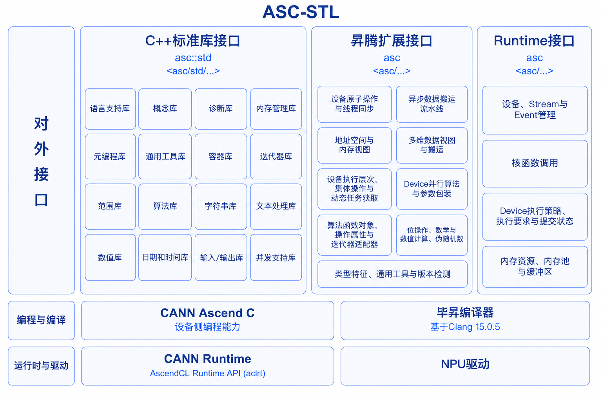

# 概览

ASC-STL 为 Host 和 Device 代码提供统一的 C++ 编程接口，最低支持 C++17。依赖 C++20 或 C++23 语言特性的接口仅在对应语言模式下开放。Device 侧代码由毕昇编译器编译，并在 Ascend 950 AI Core 上执行。



## 接口分类

ASC-STL 的公开接口分为三类：

- **C++ 标准库接口**：位于 `asc::std` 命名空间，通过 `<asc/std/...>` 头文件使用。
- **昇腾扩展接口**：位于 `asc` 命名空间，用于表达 GM、UB、Device 执行层次、设备线程协作和并行算法等平台能力。
- **运行时接口**：位于 `asc` 命名空间，用于设备、Stream、Event、核函数调用和内存资源管理。

## 可用位置

API 页面说明接口可以在哪类代码中使用：

| 可用位置 | 含义 |
| --- | --- |
| Host | 由 CPU 侧程序调用，例如创建 Stream、管理设备资源或提交异步任务 |
| AI Core SIMD 编程 | 由运行在 AI Core 上的 SIMD 代码调用 |
| AI Core SIMT 编程 | 由运行在 AI Core 上的 SIMT 代码调用 |

一个接口如果支持多个位置，页面会完整列出，例如“Host、AI Core SIMD 编程、AI Core SIMT 编程”。“头文件可包含”不等于其中的每个 API 都能在当前位置调用，应以具体 API 及原型的“可用位置”为准。

GM 指全局内存（Global Memory），UB 指 AI Core 的片上统一缓冲区（Unified Buffer）。SIMD 表示单指令处理多个数据元素，SIMT 表示单指令组织多个线程执行。页面首次介绍具体存储或线程协作要求时，会同时说明其取值、生命周期或会合条件。

## 包含和命名空间

```cpp
#include <asc/std/type_traits>
#include <asc/stream>

static_assert(asc::std::is_same_v<int, int>);
```

C++ 标准库接口不替换 Host 编译器的 `std` 命名空间。应用需要哪类能力，就显式包含对应的 ASC-STL 头文件。
